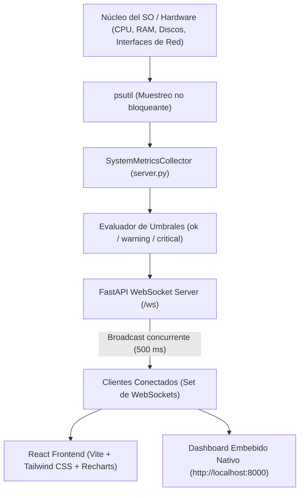

# Dashboard de Monitoreo de Sistema Operativo Nativo v2.0

Dashboard de telemetría de sistema de grado producción, ultraligero y modular en **Dark Mode** (`#0f172a`), con medición a bajo nivel, latencia ultra-baja (500 ms) y comunicación bidireccional mediante **WebSockets**.

---

## 🏛️ Arquitectura del Sistema



---

## 📊 Especificación de Módulos y Reglas de Negocio

### 1. Unidad Central de Procesamiento (CPU)
* **Porcentaje de uso global:** Carga actual del procesador calculada en modo no bloqueante.
* **Frecuencia (GHz):** Frecuencia dinámica actual vs. máxima (`psutil.cpu_freq()`). En entornos virtualizados o sin soporte del gobernador, conmuta limpiamente a `null`.
* **Temperatura (°C):** Lectura del paquete térmico (`psutil.sensors_temperatures()`). En Windows nativo conmuta a `null` de forma segura.
* **Desglose por Núcleo (Core Breakdown):** Matriz visual interactiva por cada núcleo/hilo lógico para detectar cuellos de botella monohilo (*single-thread bottlenecks*).

### 2. Memoria de Acceso Aleatorio (RAM)
* **Memoria Física:** Uso actual vs. total en GB y %.
* **Memoria Swap/Paginación:** Uso actual vs. total en GB y % para detectar saturación de memoria y prevenir degradación por trashing.

### 3. Almacenamiento (HDD/SSD)
* **Particiones Principales:** Detección dinámica de puntos de montaje (`C:`, `D:`, `/`, etc.) con espacio total, usado y libre. Manejo con `try/except (PermissionError, OSError)` para ignorar automáticamente unidades extraíbles o CD-ROMs vacíos.
* **Tasa de transferencia I/O:** Lectura y escritura en MB/s calculadas por diferencial de tiempo ($\Delta t$).
* **Tiempo de actividad del disco (%):** Porcentaje del tiempo que el disco procesa peticiones de I/O.

### 4. Interfaz de Red (Internet / LAN)
* **Ancho de banda en tiempo real:** Velocidad consolidada de bajada (*Download*) y subida (*Upload*) en MB/s y KB/s.
* **Agregación inteligente:** Suma el tráfico únicamente de interfaces de red físicas activas (`isup=True` y con IP asignada), excluyendo adaptadores loopback y virtuales desconectados.
* **Estadísticas de paquetes:** Monitoreo dinámico del porcentaje de paquetes perdidos (*drop rate %*) y recuento de errores de transmisión/recepción.

---

## 🚨 Matriz de Umbrales y Alertas

| Métrica | OK (Verde) | Warning (Ámbar) | Critical (Rojo) |
| :--- | :--- | :--- | :--- |
| **Temperatura CPU** | `< 70 °C` | `70 – 80 °C` | `> 80 °C` |
| **Uso de CPU** | `< 70 %` | `70 – 90 %` | `> 90 %` |
| **Uso de RAM** | `< 70 %` | `70 – 90 %` | `> 90 %` |
| **Uso de Swap** | `< 30 %` | `30 – 50 %` | `> 50 %` |
| **Espacio en Disco** | `< 80 %` | `80 – 95 %` | `> 95 %` |
| **Tiempo Activo Disco** | `< 60 %` | `60 – 85 %` | `> 85 %` |
| **Paquetes Perdidos Red** | `0.0 %` | `0.1 – 5.0 %` | `> 5.0 %` |

---

## 🛠️ Requisitos Previos

* **Python 3.10 o superior** (verificado en Python 3.10+ y 3.14+).
* **Node.js 18+ y npm** (para compilar y ejecutar el cliente React con Vite).
* Sistema operativo: **Windows, Linux o macOS**.

---

## 🚀 Guía de Instalación y Ejecución Local

### Paso 1: Clonar o situarse en el directorio del proyecto
```bash
cd C:\proyecto1
```

### Paso 2: Entorno Virtual e Instalación del Backend (Python)
Es recomendable utilizar un entorno virtual:
```powershell
# Crear entorno virtual (opcional pero recomendado)
python -m venv venv
.\venv\Scripts\activate

# Instalar dependencias exactas
python -m pip install -r requirements.txt
```

### Paso 3: Iniciar la Aplicación Nativa de Escritorio
Puedes iniciar la aplicación de dos formas muy sencillas:

#### Opción A: Mediante doble clic en Windows
* Haz doble clic sobre [iniciar_dashboard.bat](file:///C:/proyecto1/iniciar_dashboard.bat) (con consola informativa) o sobre [iniciar_dashboard_silencioso.vbs](file:///C:/proyecto1/iniciar_dashboard_silencioso.vbs) (directo sin ventana de consola).

#### Opción B: Mediante PowerShell o Terminal
```powershell
python server.py
```
*Esto arrancará automáticamente el backend y abrirá una **ventana de escritorio nativa de Windows** (Edge WebView2) con la interfaz React completa, gráficos en tiempo real y aceleración por hardware.*

> **💡 Modo Servidor Únicamente (Headless / Sin ventana gráfica):**
> Si prefieres ejecutar solo el servidor web en segundo plano para acceder desde navegadores o remotamente:
> ```powershell
> python server.py --server-only
> ```
> Opcionalmente puedes definir puerto y host personalizados: `python server.py --server-only --port 8080 --host 0.0.0.0`.

---

### Paso 4: Entorno de Desarrollo Frontend React (Opcional para desarrolladores)
Si deseas modificar los componentes de React o estilos en vivo con Hot Module Replacement (HMR):
```powershell
# Iniciar servidor de desarrollo Vite
npm run dev

# Para compilar una nueva versión de producción en dist/
npm run build
```

---

## 📡 Endpoints del Backend

* `GET /`: Dashboard principal (React compilado de alta fidelidad con Recharts).
* `GET /embedded`: Dashboard ligero embebido standalone (HTML5 puro sin dependencias).
* `GET /health`: Comprobación de estado y conteo de clientes activos.
* `GET /metrics/current`: Instantánea REST de todas las métricas en JSON.
* `WS /ws`: Canal WebSocket bidireccional con difusión periódica de 500 ms.

---

## 🛡️ Resistencia a Desconexiones y Gestión de Memoria

1. **Backoff Exponencial en Frontend:** `useWebSocket.js` reintenta automáticamente con intervalos de 1s, 2s, 4s, 8s hasta un tope de 16s.
2. **Congelamiento de Estado (Anti-Flicker):** Si la conexión con el backend se interrumpe, el estado visual se congela sin borrar los buffers ni poner valores a cero, desplegando un banner de advertencia superior.
3. **Búfer Fijo contra Fugas de Memoria:** Los gráficos temporales de CPU y Red limitan estrictamente su tamaño a **60 puntos** (30 segundos) mediante `slice(-60)`, garantizando un consumo de RAM constante e infinitamente estable en el navegador.
